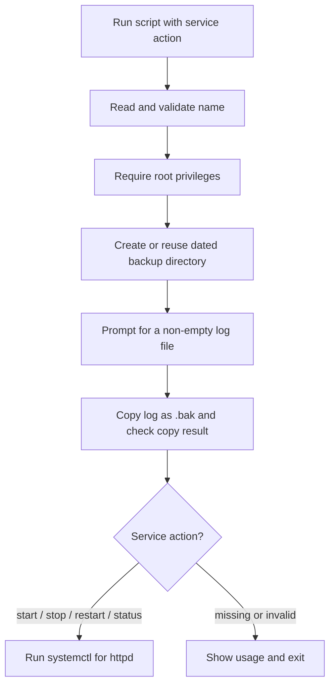
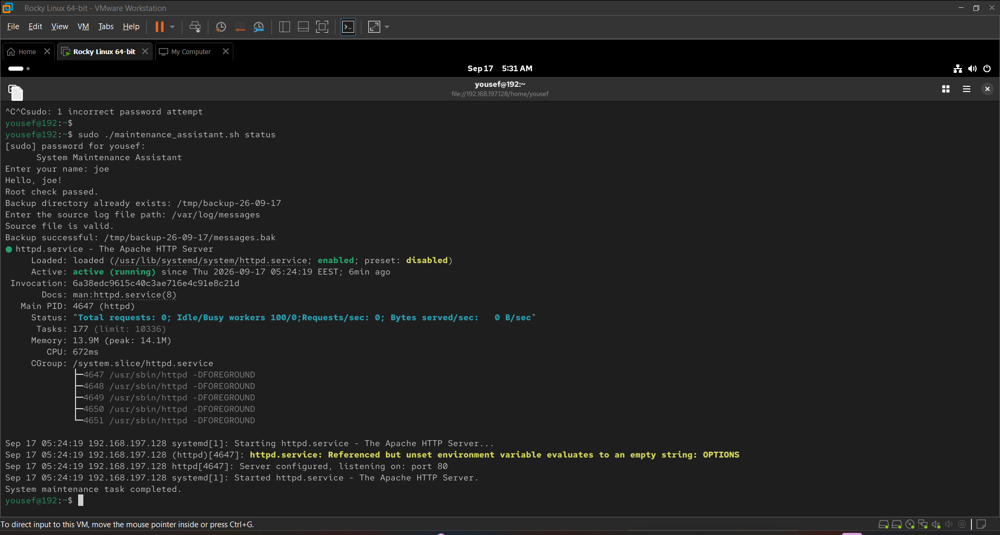
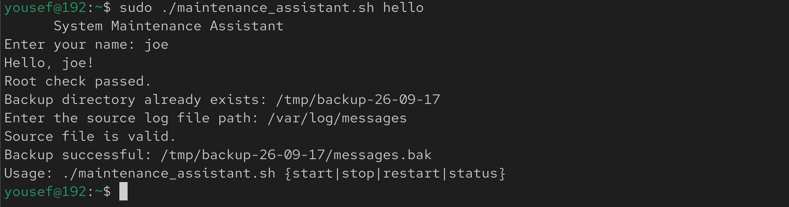

# Bash System Maintenance Assistant

A Bash-based system administration lab that combines input validation, a dated log-file backup, a root privilege check, and Apache service management on Rocky Linux.

This repository contains the **original script used in the submitted VMware lab**, along with the submission report and screenshots of actual terminal runs. It documents a training exercise, not a production maintenance utility.

## Project overview

The script prompts an administrator for a name and a source log file, validates the inputs, and copies the selected non-empty log to a date-based directory under `/tmp`. It then handles one command-line action for the `httpd` service: `start`, `stop`, `restart`, or `status`.

The implementation was demonstrated on a **Rocky Linux virtual machine using VMware**, with `/var/log/messages` as the source and `httpd` as the managed service.

## Objectives and skills demonstrated

| Objective | Bash/Linux feature used |
| --- | --- |
| Collect and validate interactive input | `read -r -p`, string check with `-z` |
| Require administrator privileges | Effective user ID (`$EUID`) |
| Create a reusable daily backup location | `date`, `-d`, `mkdir -p` |
| Validate the log file | Regular-file check (`-f`), non-empty check (`-s`) |
| Back up a selected file | `basename`, `cp`, command exit status (`$?`) |
| Dispatch service actions | Positional argument `$1`, `case`, `systemctl` |
| Handle selected error cases | Error messages, exit codes, usage text |

## Environment and tools

- **Operating system:** Rocky Linux (VMware virtual machine)
- **Language:** Bash
- **Service manager:** `systemd` / `systemctl`
- **Managed service:** Apache HTTP Server (`httpd`)
- **Utilities:** `date`, `mkdir`, `basename`, `cp`
- **Permissions:** Run with `sudo` or as root

The script sets `SERVICE="httpd"` directly. It does **not** automatically detect or manage Ubuntu's `apache2` service.

## How it works



The checks for an empty name, insufficient privileges, an invalid source file, and a failed copy can stop execution early. **The command-line service action is checked only after the backup step**; this is a limitation of the original implementation.

## Project structure

```text
bash-system-maintenance-assistant/
├── README.md
├── .gitignore
├── scripts/
│   └── maintenance_assistant.sh
├── screenshots/
│   ├── successful-status-check.png
│   ├── backup-file-created.png
│   ├── non-root-rejected.png
│   └── invalid-action.png
└── reports/
    └── system-maintenance-assistant-submission.pdf
```

The original course assignment PDF is deliberately excluded because it belongs to the course author. No real log file, backup copy, or credential is included.

## Prerequisites

Use an isolated lab VM or other system you are authorized to administer, with:

1. Bash and a working `systemd` installation.
2. An installed `httpd` service.
3. `sudo` access (the script requires root privileges).
4. An existing, non-empty log file readable by root, such as `/var/log/messages` on the Rocky Linux lab VM.

**Caution:** This script makes file-system changes even with the `status` action, because it creates or reuses a backup directory and copies the source file. The `start`, `stop`, and `restart` options also change service state. Use it only where those operations are acceptable.

## Running the script

From the repository root:

**1. Check the script syntax (does not run the maintenance tasks):**

```bash
bash -n scripts/maintenance_assistant.sh
```

**2. Run the status example on the Rocky Linux lab VM:**

```bash
sudo ./scripts/maintenance_assistant.sh status
```

You will be asked to enter:

- Your name (must not be empty).
- A full path to an existing, non-empty log file (the report used `/var/log/messages`).

In the demonstrated run, the backup path was:

```text
/tmp/backup-26-09-17/messages.bak
```

The date is generated at runtime using `date +%y-%m-%d`; the path above is from the **September 17, 2026** screenshot, not a fixed output path.

**3. Other implemented service actions:**

```bash
sudo ./scripts/maintenance_assistant.sh start
sudo ./scripts/maintenance_assistant.sh stop
sudo ./scripts/maintenance_assistant.sh restart
```

These branches exist in the original source, but the supplied submission does **not** independently demonstrate successful execution of `start`, `stop`, or `restart`. They are listed as implemented options, not verified outcomes.

## Implementation details

### Input and privilege checks

- `read -r -p` prompts for a name and later a source log path.
- `-z "$NAME"` rejects an empty name.
- `[ "$EUID" -ne 0 ]` exits unless the effective user is root.

### Dated backup and validation

- `date +%y-%m-%d` produces a two-digit-year date suffix.
- `BACKUP_DIR="/tmp/backup-$CURRENT_DATE"` selects the backup directory.
- `-d` checks whether that directory already exists; otherwise `mkdir -p` creates it.
- `-f` verifies the input path is a regular file, and `-s` verifies it is not empty.
- `basename` produces the destination filename, and `cp` creates a copy with a `.bak` extension.
- The script checks the exit code of `cp` and reports a backup failure if copying fails.

### Service control

The `case "$1"` statement selects the requested `systemctl` operation for the **hardcoded `httpd` service**. `status` uses `--no-pager` for terminal-friendly output. A missing or unrecognized action displays the accepted arguments and exits.

## Testing and validation

The following outcomes are supported by the original submission screenshots:

| Scenario | Evidence | Observed result |
| --- | --- | --- |
| Run with `sudo` and `status` | [Successful execution](screenshots/successful-status-check.png) | Log validated and copied; `httpd` reported `active (running)` |
| Inspect the backup folder | [Backup listing](screenshots/backup-file-created.png) | `messages.bak` present, approximately **395K** in the reported run |
| Run without `sudo` | [Non-root rejection](screenshots/non-root-rejected.png) | Script printed the root privilege error and exited |
| Run with an invalid action (`hello`) | [Invalid action](screenshots/invalid-action.png) | Script displayed its usage message **after making a backup** |

The `-f` and `-s` validation branches, empty-name rejection, copy-failure handling, and `start`/`stop`/`restart` operations are visible in the source. Separate execution screenshots for those cases were **not supplied**.

### Screenshot: completed status check



### Screenshot: invalid action



The four images were extracted from the author's submission report without generating or altering the terminal output. The [full submission report](reports/system-maintenance-assistant-submission.pdf) is retained for context.

## Results

In the documented Rocky Linux run, the script:

1. Accepted the operator's name and passed the root check.
2. Reused the date-based backup directory.
3. Validated and copied `/var/log/messages` to `messages.bak`.
4. Displayed the Apache `httpd` service as active using `systemctl status`.
5. Demonstrated rejection of a non-root execution and an unsupported action in separate runs.

This evidence demonstrates interactive shell scripting, basic system administration checks, file backup logic, and service inspection in a VM environment.

## Limitations and security considerations

This is the original completed training script, **not a hardened backup system**:

- It supports the named `httpd` service only; service discovery is not implemented in this version.
- It validates the service action *after* the backup, so an invalid argument can still create or overwrite a backup.
- Repeated runs on the same day use the same destination filename and may overwrite the previous `.bak` file.
- `/tmp` is temporary storage, not a durable backup destination. The script does not set restrictive permissions or manage backup retention; use care with sensitive logs.
- The script checks whether `cp` succeeds, but it does **not** check the result of `systemctl start`, `stop`, or `restart` before displaying success messages.
- The supplied evidence does not demonstrate production reliability or automated testing.

Do not commit actual system logs, copied backups, passwords, keys, or tokens. The screenshots show a private VMware lab address and a local account name, not public service endpoints.

## Potential future improvements

The following are ideas **not implemented in the submitted version**:

1. Validate the service action before any side effects.
2. Check and propagate all `systemctl` return codes.
3. Support configurable services and backup locations.
4. Use a restricted backup directory, safer file permissions, and a retention policy.
5. Add automated tests for empty input, missing files, and command failures.

## Attribution

Completed as a Bash scripting training assignment. The script, report, and screenshots document the author's hands-on work; the instructor's original assignment handout is not redistributed in this repository.
